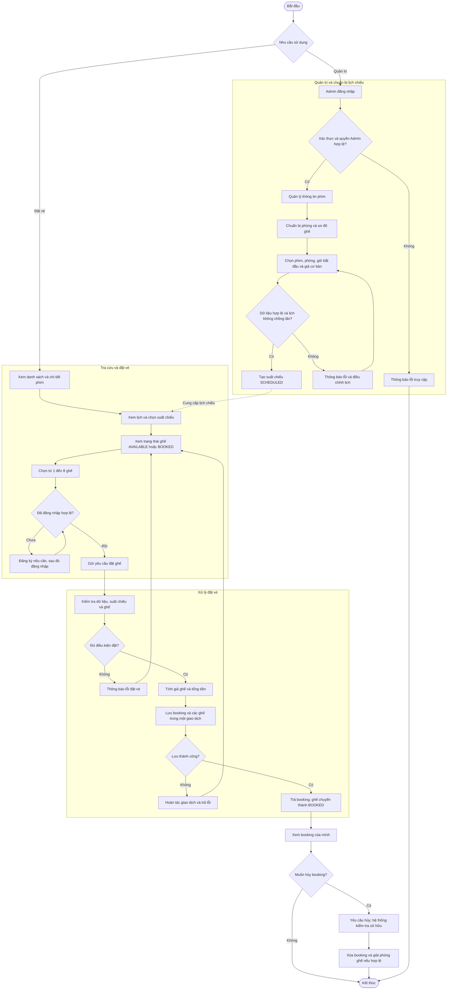
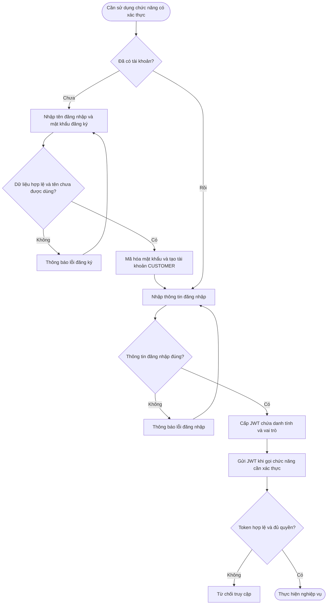
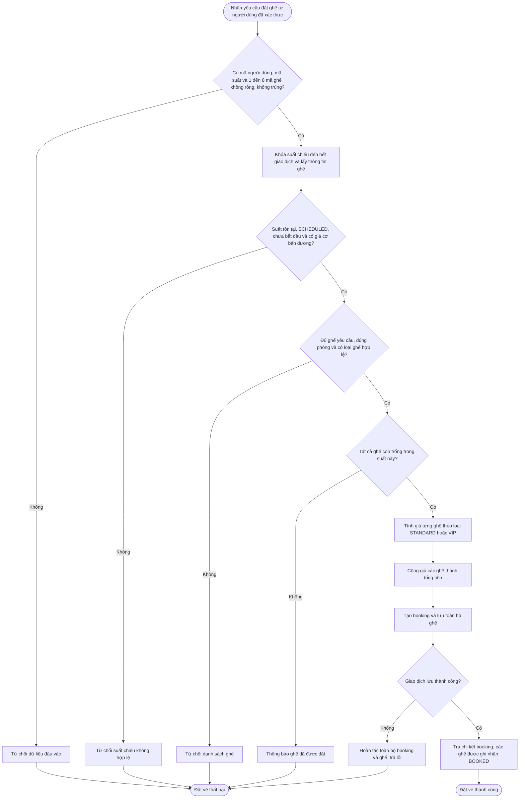
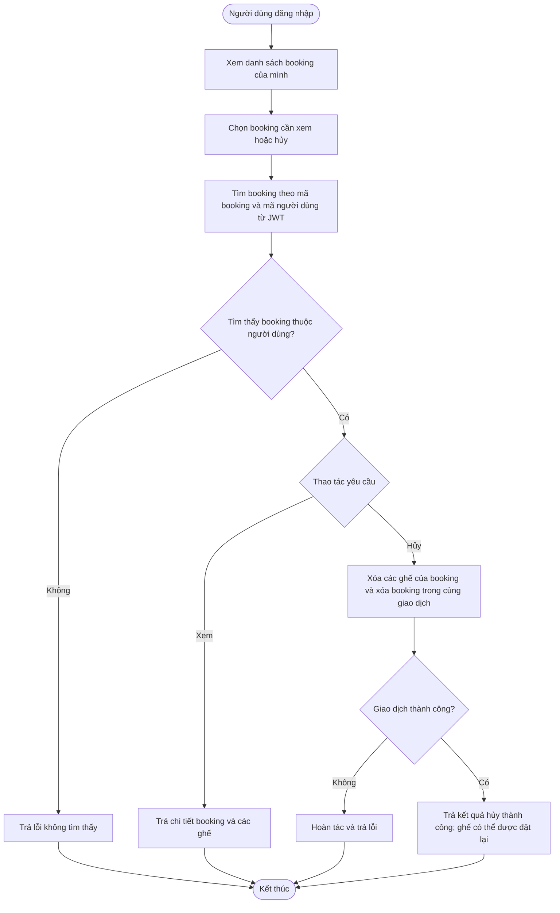
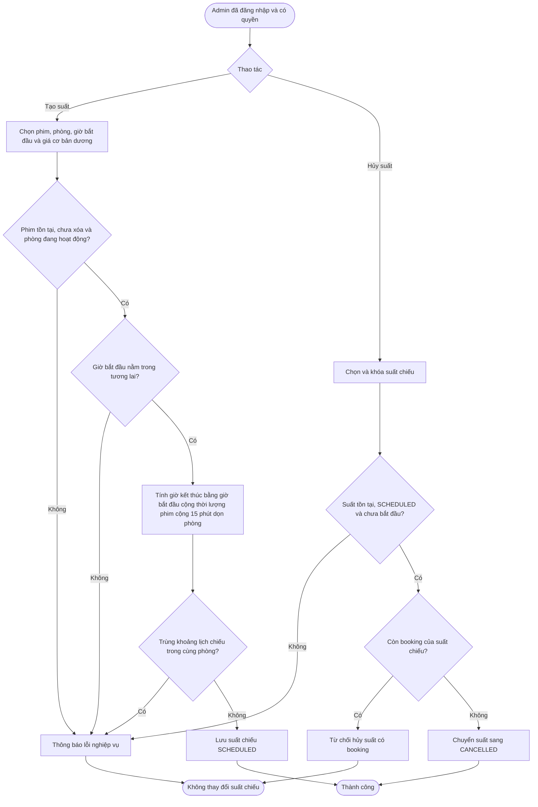

# Sơ đồ luồng nghiệp vụ hệ thống quản lý rạp phim

Tài liệu mô tả luồng nghiệp vụ theo mã nguồn hiện tại, đối chiếu ngày 29/10/2026. Sơ đồ dùng Mermaid; mở file bằng trình xem Markdown hỗ trợ Mermaid để hiển thị.

## 1. Phạm vi và tác nhân

| Tác nhân | Hoạt động |
|---|---|
| Khách vãng lai (Guest) | Xem phim, lịch chiếu, trạng thái ghế; đăng ký và đăng nhập |
| Khách hàng (Customer) | Đặt ghế, xem danh sách/chi tiết và hủy booking của mình sau khi đăng nhập |
| Quản trị viên (Admin) | Quản lý phim, phòng và sơ đồ ghế; tạo và hủy suất chiếu |
| Hệ thống | Xác thực, kiểm tra điều kiện nghiệp vụ, tính giá, lưu booking và bảo vệ ghế khỏi đặt trùng |

Hệ thống phục vụ một địa điểm rạp có nhiều phòng chiếu. Booking là một lần đặt từ 1 đến 8 ghế trong cùng một suất chiếu. Các hoạt động dưới đây được thực hiện qua API; dự án chưa có giao diện khách hàng riêng.

## 2. Sơ đồ nghiệp vụ tổng thể

Các đường quay lại chọn ghế biểu diễn cách khách có thể thao tác tiếp sau lỗi; API không tự động chọn hoặc thử đặt ghế thay khách.

## 3. Luồng đăng ký và đăng nhập

Đăng ký công khai luôn tạo tài khoản `CUSTOMER`. Các API quản trị yêu cầu vai trò `ADMIN`. Khi xử lý booking, hệ thống lấy mã người dùng từ JWT đã xác thực.

## 4. Luồng đặt ghế chi tiết

| Quy tắc | Nội dung |
|---|---|
| Số lượng | Mỗi booking có 1–8 ghế; không chấp nhận mã ghế trùng hoặc rỗng |
| Suất chiếu | Phải tồn tại, có trạng thái `SCHEDULED` và thời điểm bắt đầu nằm trong tương lai |
| Ghế | Phải thuộc phòng của suất chiếu và chưa được đặt trong chính suất đó |
| Giá STANDARD | Bằng giá cơ bản của suất chiếu |
| Giá VIP | Bằng giá cơ bản nhân `1.20` |
| Tổng tiền | Tổng giá đã chốt của từng ghế; giá ghế và tổng tiền làm tròn 2 chữ số thập phân, `HALF_UP` |
| Nguồn giá | Hệ thống tự tính từ dữ liệu suất chiếu và loại ghế, không nhận giá do khách tự khai |
| Chống đặt trùng | Khóa suất chiếu trong giao dịch; ràng buộc duy nhất cho cặp suất chiếu và ghế tại cơ sở dữ liệu |
| Tính toàn vẹn | Booking và các ghế được lưu cùng giao dịch; lưu thất bại thì hoàn tác toàn bộ |

**Lưu ý về thanh toán:** booking hiện được ghi nhận ngay khi lưu thành công và giữ ghế. Trường `paymentStatus` khởi tạo là `PENDING`, nhưng chưa có luồng thanh toán thật hay tự động hết hạn. Đây là trạng thái thanh toán, không phải trạng thái giữ ghế tạm.

## 5. Luồng xem và hủy booking

Hiện tại hủy booking là **xóa vật lý**, chưa lưu lịch sử với trạng thái `CANCELLED`. Mã nguồn chưa kiểm tra mốc hủy trước giờ chiếu 30 phút; không đưa điều kiện dự kiến này vào sơ đồ hiện trạng.

## 6. Luồng tạo và hủy suất chiếu của Admin

- Admin cần chuẩn bị phim, phòng và sơ đồ ghế trước khi tạo suất; phim và phòng có thể được tạo theo thứ tự bất kỳ.
- Phim được xóa mềm. Phòng cũng được xóa mềm và không được xóa khi còn suất `SCHEDULED` trong tương lai.
- Tạo booking và hủy suất dùng chung cơ chế khóa suất chiếu để tránh đồng thời đặt thành công vào một suất vừa bị hủy.
- Guard hủy suất hiện xem mọi booking còn lưu là booking đã xác nhận, kể cả khi `paymentStatus = PENDING`.

## 7. Phân biệt hiện trạng và yêu cầu dự kiến

Một số nội dung trong tài liệu đặc tả/yêu cầu là định hướng, chưa phản ánh đầy đủ mã nguồn hiện tại:

| Nội dung | Hiện trạng dùng trong sơ đồ |
|---|---|
| Danh tính và quyền sở hữu booking | Đã lấy người dùng từ JWT; truy vấn xem/hủy theo cả mã booking và mã người dùng |
| Hủy booking | Xóa vật lý và giải phóng ghế; chưa có hủy mềm hoặc mốc 30 phút |
| Trạng thái booking | Chưa có trường trạng thái `CONFIRMED`/`CANCELLED`; booking còn lưu được coi là đã xác nhận |
| Thanh toán | Có trường trạng thái thanh toán; chưa có quy trình thanh toán/hoàn tiền thật |
| Giữ ghế tạm và hết hạn | Chưa triển khai |
| Admin xem mọi booking | Chưa có endpoint riêng cho chức năng này |

## 8. Nguồn đối chiếu

- [README dự án](../README.md), [đặc tả hệ thống](SPEC.md) và [yêu cầu Booking](booking_requirements.md).
- [Xác thực và phân quyền](../src/main/java/com/example/cinema/config/SecurityConfig.java).
- [Nghiệp vụ tài khoản](../src/main/java/com/example/cinema/modules/identity/business/IdentityService.java).
- [API booking](../src/main/java/com/example/cinema/modules/booking/api/BookingController.java) và [nghiệp vụ booking](../src/main/java/com/example/cinema/modules/booking/business/BookingService.java).
- [Lưu và xóa booking, kiểm tra booking khi hủy suất](../src/main/java/com/example/cinema/modules/booking/data/BookingRepositoryAdapter.java).
- [Nghiệp vụ suất chiếu](../src/main/java/com/example/cinema/modules/theater/business/ShowtimeService.java) và [nghiệp vụ phòng chiếu](../src/main/java/com/example/cinema/modules/theater/business/AuditoriumService.java).

Khi tài liệu cũ và mã nguồn khác nhau, tài liệu này ưu tiên hành vi trong mã nguồn để mô tả luồng hiện tại.
